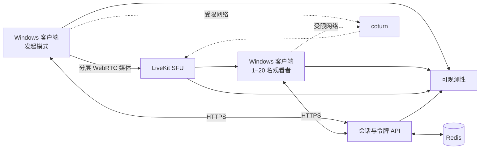

# 系统架构

## 1. 架构目标

系统需要在基准设备和网络环境下，将一台 Windows 主机的屏幕以最高 2560×1440@60fps 分发给最多 20 名软件内观看者，同时保持低延迟、可降级、可观测和最小权限。

## 2. 上下文



发起端不与每位观看者建立独立媒体上行。发起端发布少量质量层，SFU 根据每位观看者的窗口大小、带宽和解码能力选择转发层。

## 3. 组件职责

### 3.1 统一 Windows 客户端

客户端包含两个互斥角色：

- 发起模式：选择捕获源、采集帧、编码、发布、管理房间和观众。
- 观看模式：加入房间、订阅、解码、渲染、选择最高质量并展示状态。

客户端内部模块：

| 模块 | 职责 | 不负责 |
| --- | --- | --- |
| UI Shell | 页面、状态展示、用户操作 | 直接处理媒体线程 |
| Session State Machine | 角色、连接和重连状态 | 编解码实现 |
| WGC Capture | 获取屏幕/窗口 D3D11 帧 | 网络发送 |
| Media Adapter | 封装 LiveKit 发布、订阅和 stats | 业务鉴权 |
| D3D11 Renderer | 低延迟显示远端视频帧 | 房间管理 |
| Diagnostics | 分段耗时、帧率和脱敏日志 | 保存屏幕内容 |

### 3.2 会话与令牌 API

- 创建、查询和结束房间。
- 将加入码兑换为分钟级房间令牌。
- 强制 1 名发起者和 20 名观看者上限。
- 主持人令牌仅允许发布屏幕，观看者令牌仅允许订阅。
- 管理撤销、限流、主持人恢复窗口和脱敏审计事件。

会话 API 不处理 SDP/RTP，不接收屏幕帧。

### 3.3 LiveKit SFU

- 终止 WebRTC 传输并路由媒体包。
- 为不同观看者选择 simulcast 层。
- 提供拥塞控制、重传和房间参与者事件。
- 输出节点 CPU、内存、入口/出口带宽和媒体质量指标。

### 3.4 coturn

- 为 UDP 不可达或严格防火墙环境提供 UDP、TCP、TLS 443 连接路径。
- 使用短时凭证；不得配置公开匿名中继。
- 与 SFU 分开监控带宽和连接数。

### 3.5 Redis

- 临时房间状态和人数并发控制。
- 令牌撤销、加入码、速率限制和多 API 实例协调。
- 不保存屏幕内容或媒体包。

## 4. 媒体管线

发送路径：

```text
Windows.Graphics.Capture
  → D3D11 Capture Frame
  → 尺寸/色彩处理
  → LiveKit VideoSource
  → H.264 硬件编码
  → 720p30 / 1080p60 / 1440p60 质量层
  → WebRTC
  → SFU
```

接收路径：

```text
SFU
  → WebRTC
  → H.264 硬件解码
  → 帧队列（有界、允许丢旧帧）
  → D3D11 Renderer
  → Qt 窗口
```

设计约束：

- 媒体线程不得等待 UI 线程。
- 渲染队列必须有界；实时性优先于播放所有历史帧。
- 任何 GPU→CPU→GPU 拷贝必须被性能追踪记录。
- 2K60 编码失败时依次降级到 1080p60、1080p30、720p30。
- 没有观看者订阅最高层时暂停最高层编码。

## 5. 角色与信任边界

| 角色 | 创建房间 | 发布屏幕 | 订阅屏幕 | 移除观众 | 结束房间 |
| --- | --- | --- | --- | --- | --- |
| 发起者 | 是 | 是 | 否 | 是 | 是 |
| 观看者 | 否 | 否 | 是 | 否 | 否 |
| 运维人员 | 否 | 否 | 否 | 否 | 仅故障处置接口 |

所有权限由服务端签名令牌决定，客户端 UI 隐藏按钮不能作为权限控制。

## 6. 部署拓扑

开发环境使用 Docker Compose 启动会话 API、Redis、LiveKit、coturn 和监控组件。生产环境将 API、SFU、TURN 分别部署并扩容：

- 单个满载房间按 500Mbps SFU 出口预算。
- SFU 节点至少使用独享 1Gbps 网络。
- 一个房间在同一时刻固定到一个 SFU 节点。
- TURN 带宽独立计量，避免掩盖 SFU 容量。
- TLS 证书、LiveKit 密钥和 TURN 密钥仅通过部署密钥系统注入。

## 7. 故障与恢复

- API 暂时不可用：已建立的媒体会话继续，禁止签发新令牌。
- Redis 暂时不可用：拒绝创建或加入，避免突破人数和权限约束。
- SFU 断开：客户端指数退避重连；首版不承诺无缝跨节点迁移。
- TURN 断开：尝试已有直连路径或重新进行 ICE；不得无限重试。
- 发起端断线：保留短暂恢复窗口，超时后结束房间并撤销观看令牌。
- GPU 设备丢失：停止发布，重建 D3D11 资源并向所有观看端显示恢复状态。

## 8. 不可变约束

- 默认不录制、不截图、不保存 RTP 包。
- 观看者永远不能通过客户端请求提升为发布者。
- 第 21 名观看者必须在签发媒体令牌前被拒绝。
- 未通过性能闸门前不得宣称支持相应画质。
