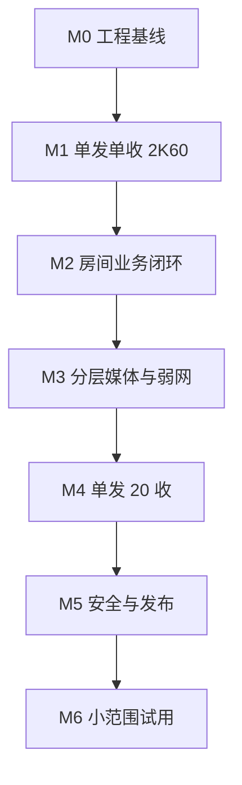

# 开发顺序与里程碑

## 1. 排序原则

开发顺序由风险和依赖决定，而不是由页面可见度决定：

1. 先验证最难替换的媒体技术。
2. 再完成最小业务闭环。
3. 再验证 20 人容量和复杂网络。
4. 最后补齐发布、安全和运营能力。

任何阶段的退出条件未满足时，不并行开发其下游功能。

## 2. 依赖关系

## 3. 硬性开发顺序

当前进度：M0 已完成，M1-01 至 M1-05 已实现；Windows CI 覆盖 SDK 下载、发布/订阅适配层编译和无网络单元测试。下一个任务是 M1-06 补齐六段媒体指标。双客户端实机链路、画质和容量仍需通过 QG-1 验证。

### M0：工程基线（第 1 周前半）

目标：仓库可重复构建，模块边界确定。

按顺序执行：

1. `M0-01` 初始化 C++20、Qt 6、CMake Presets 和目录结构。
2. `M0-02` 集成格式化、静态检查、单元测试和 CI 骨架。
3. `M0-03` 锁定 LiveKit C++ SDK、Qt 和工具链版本。
4. `M0-04` 启动本地 LiveKit、coturn、Redis 与最小会话 API。
5. `M0-05` 定义统一错误码、日志字段和性能指标名。

退出条件：一条命令能够在干净环境完成配置、构建和测试；依赖版本可追溯。

### M1：单发单收 2K60 技术闸门（第 1–2 周）

目标：确认生产媒体路径能够达到核心性能要求。

按顺序执行：

1. `M1-01` 枚举并选择屏幕或窗口。
2. `M1-02` 使用 Windows.Graphics.Capture 获取 D3D11 帧。
3. `M1-03` 实现低延迟本地预览和 capture fps 统计。
4. `M1-04` 将原始帧发布为 LiveKit 屏幕轨道。
5. `M1-05` 接收、解码并在另一个客户端窗口渲染。
6. `M1-06` 采集 capture/encode/send/receive/decode/render 六段指标。
7. `M1-07` 在 Intel、NVIDIA、AMD 基准设备上分别跑 1080p60 和 1440p60。
8. `M1-08` 连续运行 30 分钟并检查帧率、延迟、内存和设备丢失恢复。

退出条件：满足 [QG-1](quality-gates.md#qg-1单发单收-2k60)。若普通原始帧路径失败，立即切换预编码输入方案并重新验证，不进入 M2。

### M2：统一客户端和房间闭环（第 3–4 周）

目标：两种角色可以完成端到端业务流程。

按顺序执行：

1. `M2-01` 实现发起/加入首页与显式角色状态机。
2. `M2-02` 实现房间创建、加入码和深链接。
3. `M2-03` 签发主持人发布令牌与观看者订阅令牌。
4. `M2-04` 实现软件内播放、全屏和画面适配。
5. `M2-05` 实现暂停、恢复、结束和观看者离开。
6. `M2-06` 实现 20 人原子计数及第 21 人拒绝。
7. `M2-07` 实现信令断开、ICE restart 和重新加入。
8. `M2-08` 完成会话 API 集成测试和双客户端端到端测试。

退出条件：满足 [QG-2](quality-gates.md#qg-2房间业务闭环)。

### M3：分层媒体与弱网策略（第 5–6 周）

目标：不同观看者独立获得合适画质。

按顺序执行：

1. `M3-01` 发布 720p30、1080p60、1440p60 三个质量层。
2. `M3-02` 实现自动、流畅、1080p60、2K60 观看策略。
3. `M3-03` 根据窗口可见性和尺寸切换订阅层。
4. `M3-04` 无人订阅时暂停对应高质量编码层。
5. `M3-05` 实现拥塞、丢包和编码失败降级链。
6. `M3-06` 验证 TURN UDP、TCP、TLS 443。
7. `M3-07` 覆盖切网、瞬断、IP 变化和严格 NAT。

退出条件：满足 [QG-3](quality-gates.md#qg-3分层与弱网)。

### M4：单发 20 收容量闸门（第 7 周）

目标：证明房间人数与画质目标可以同时成立。

按顺序执行：

1. `M4-01` 建立无 UI 观看者压测客户端。
2. `M4-02` 依次压测 1、5、10、20 名观看者。
3. `M4-03` 混合订阅 720p、1080p、1440p 层。
4. `M4-04` 20 人同时订阅 2K60，测量 SFU 和 TURN 容量。
5. `M4-05` 优化帧队列、GPU 拷贝、关键帧和重传策略。
6. `M4-06` 运行 2 小时稳定性测试。
7. `M4-07` 输出可复现的容量报告和安全余量。

退出条件：满足 [QG-4](quality-gates.md#qg-4单发-20-收)。

### M5：安全、安装与可运维性（第 8–9 周）

目标：从实验程序变成可安全分发的软件。

按顺序执行：

1. `M5-01` 完成威胁建模、令牌撤销、限流和日志脱敏。
2. `M5-02` 完成安装包、代码签名和卸载验证。
3. `M5-03` 完成安全自动更新、灰度和回滚。
4. `M5-04` 建立 Prometheus/Grafana 质量与容量仪表盘。
5. `M5-05` 覆盖锁屏、休眠、显示器拔插、DPI/HDR、GPU 设备丢失。
6. `M5-06` 编写部署、告警、扩容、回滚和故障处理手册。
7. `M5-07` 完成依赖漏洞扫描和发布候选版本检查。

退出条件：满足 [QG-5](quality-gates.md#qg-5发布候选)。

### M6：小范围试用（第 10 周）

目标：用真实设备和网络验证实验室之外的表现。

按顺序执行：

1. `M6-01` 灰度分发给 20–50 名试用者。
2. `M6-02` 覆盖家庭网、办公网、校园网和移动热点。
3. `M6-03` 观察连接成功率、首帧、冻结、2K60 达标率和带宽成本。
4. `M6-04` 只修复阻断问题，不在试用期扩展产品范围。
5. `M6-05` 召开发布评审并形成 go/no-go 记录。

退出条件：连续一周无 P0/P1 问题，并达到产品指标。

## 4. 明确禁止的并行工作

- QG-1 前不开发复杂房间 UI、聊天、账号或后台管理。
- QG-2 前不开始 20 人优化，因为业务状态仍不稳定。
- QG-3 前不做带宽成本推算，因为媒体层策略尚未固定。
- QG-4 前不宣称支持 20 人或 2K60。
- QG-5 前不公开发布安装包。
- MVP 完成前不加入远程控制、录制、文件传输或跨平台。

## 5. GitHub 里程碑映射

| GitHub 里程碑 | 对应阶段 | 完成定义 |
| --- | --- | --- |
| `M0 Engineering Baseline` | M0 | 可重复构建和测试 |
| `M1 2K60 Media Spike` | M1 | QG-1 通过 |
| `M2 Room MVP` | M2 | QG-2 通过 |
| `M3 Adaptive Media` | M3 | QG-3 通过 |
| `M4 20-Viewer Capacity` | M4 | QG-4 通过 |
| `M5 Release Candidate` | M5 | QG-5 通过 |
| `M6 Pilot` | M6 | 发布评审通过 |
