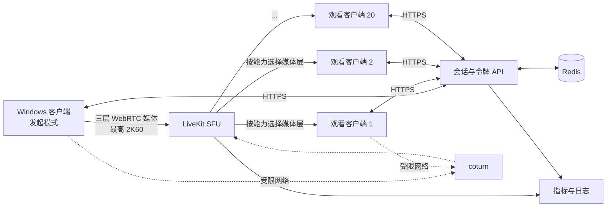

# 实时远程屏幕共享软件：产品与技术方案

> 版本：V2（20 人软件内观看、1080p/2K 60fps）
> 约定：本文中的“2K”统一指 2560×1440，而不是影院标准 2048×1080。

## 1. 产品目标

### 1.1 产品定位

为远程演示、技术支持和团队协作提供一款 Windows 实时屏幕共享软件。发起者与观看者使用同一款桌面客户端：发起者选择屏幕或窗口并创建房间，观看者在软件内输入加入码或通过深链接进入房间。

首版重点不是会议功能，而是稳定、低延迟地向最多 20 名观看者分发高帧率桌面画面。

### 1.2 已确定的 MVP 边界

- Windows 10/11 统一桌面客户端，包含“发起共享”和“加入观看”两种模式。
- 每个房间最多 1 名发起者和 20 名观看者，共 21 个在线参与者。
- 支持整个显示器或指定窗口。
- 支持 1080p60 与 2560×1440@60fps 高画质档位。
- 支持自动、流畅、1080p60、2K60 四种观看策略。
- 使用 SFU 分发媒体，发起者不为每名观看者分别上传一条流。
- 支持公网连接、TURN 兜底、自适应码率和断线重连。
- 通过加入码或 `screenshare://` 深链接在软件内部加入。

首版不包含：

- 浏览器观看端。
- 键盘鼠标远程控制。
- 摄像头、多人语音、文字聊天。
- 文件传输、剪贴板同步。
- 云端录制、回放和截图留存。
- macOS、Linux 和移动端。

### 1.3 MVP 成功标准

| 指标 | 验收目标 |
| --- | --- |
| 房间容量 | 1 名发起者 + 20 名同时观看者 |
| 画质档位 | 1920×1080@60fps、2560×1440@60fps |
| 帧率 | 基准环境连续 10 分钟平均渲染帧率不低于 55fps |
| 端到端延迟 | 同区域、RTT≤80ms 时 P95 不高于 500ms，目标 300ms |
| 首帧时间 | 加入房间后 P95 不高于 5 秒 |
| 公网连接成功率 | TURN 可用时不低于 98% |
| 房间稳定性 | 21 人连续运行 2 小时，无崩溃、永久黑屏或全房间中断 |
| 自适应降级 | 带宽不足时主动降清晰度或帧率，不允许长时间冻结 |
| 权限隔离 | 观看者只能订阅，不能发布画面或结束房间 |

“达到 60fps”按接收端实际解码并渲染的帧数验收，不能只检查采集参数或发送端声明值。

## 2. 用户角色与主流程

### 2.1 用户角色

- 发起者：创建房间、选择分享源、设置画质、管理观众并结束共享。
- 观看者：在软件内加入房间、选择观看画质、全屏观看并查看网络状态。
- 运维人员：部署会话服务、SFU、TURN 和监控系统；不接触屏幕内容。

### 2.2 发起共享

1. 用户打开客户端并选择“发起共享”。
2. 客户端展示屏幕和窗口缩略图，用户明确选择目标。
3. 客户端检测分辨率、刷新率、硬件编码能力和上行带宽。
4. 用户选择“自动”“1080p60”或“2K60”并创建房间。
5. 服务端签发仅允许发布屏幕的主持人令牌和仅允许订阅的观看令牌。
6. 客户端持续显示正在共享的目标、观众人数和实际发送质量。
7. 发起者可暂停、恢复、移除观众或立即结束房间。

### 2.3 加入观看

1. 观看者在客户端输入短时加入码，或点击深链接唤起客户端。
2. 服务端校验房间、令牌、人数上限和限流策略。
3. 客户端连接 SFU 并默认使用“自动”画质。
4. SFU 根据观看窗口尺寸、设备解码能力和网络状态选择分层码流。
5. 观看者可切换全屏、画面适配方式和允许的最高质量。
6. 房间暂停、重连或结束时，客户端显示明确状态。

## 3. 功能需求

### 3.1 统一桌面客户端

| 编号 | 优先级 | 需求 | 验收方式 |
| --- | --- | --- | --- |
| C-01 | P0 | 首页提供发起和加入两个入口 | 两种角色无需安装不同软件 |
| C-02 | P0 | 支持加入码和深链接 | 深链接只唤起客户端，不在浏览器中播放 |
| C-03 | P0 | 显示当前角色、连接状态和网络质量 | 不得用模糊的单一“在线”状态代替 |
| C-04 | P0 | 网络变化后自动重连 | 短暂断网恢复后无需重新进入房间 |
| C-05 | P0 | 安全自动更新和版本兼容检查 | 强制升级前给出明确说明 |
| C-06 | P1 | 导出脱敏诊断日志 | 不包含令牌、窗口标题和画面内容 |

### 3.2 发起端能力

| 编号 | 优先级 | 需求 | 验收方式 |
| --- | --- | --- | --- |
| H-01 | P0 | 枚举并预览屏幕和窗口 | 多显示器、不同 DPI 下可正确区分 |
| H-02 | P0 | 创建、暂停、恢复、结束共享 | 20 个观看端在 2 秒内同步状态 |
| H-03 | P0 | 展示并复制加入码与深链接 | 会话结束后立即失效 |
| H-04 | P0 | 选择自动、1080p60、2K60 | 不满足条件时解释原因并安全降级 |
| H-05 | P0 | 显示实时观众数，最多 20 人 | 第 21 名观看者被明确拒绝 |
| H-06 | P0 | 显示实际采集/编码帧率、码率、丢包和 RTT | 数据来自真实统计而非配置值 |
| H-07 | P0 | 支持硬件编码，失败时降级 | 不得因编码器异常导致客户端崩溃 |
| H-08 | P1 | 发起者移除指定观看者 | 被移除令牌不可立即重用 |

### 3.3 观看端能力

| 编号 | 优先级 | 需求 | 验收方式 |
| --- | --- | --- | --- |
| V-01 | P0 | 在软件内部实时播放 | 不跳转浏览器或依赖外部播放器 |
| V-02 | P0 | 支持窗口、等比适配和全屏 | 切换时不重连媒体 |
| V-03 | P0 | 支持自动、流畅、1080p60、2K60 | 选项受源质量和设备能力约束 |
| V-04 | P0 | 展示实际接收分辨率和帧率 | 能区分目标质量与实际质量 |
| V-05 | P0 | 自动重连和恢复播放 | ICE 重启失败后才重新加入房间 |
| V-06 | P0 | 显示等待、连接、暂停、降级、结束和错误状态 | 每种状态均可测试 |
| V-07 | P1 | 发送匿名质量反馈 | 仅上传技术指标与用户主动填写文字 |

### 3.4 房间与服务端

| 编号 | 优先级 | 需求 | 验收方式 |
| --- | --- | --- | --- |
| S-01 | P0 | 管理房间完整生命周期 | 创建、活跃、暂停、结束、过期状态明确 |
| S-02 | P0 | 强制 20 名观看者上限 | 并发加入时也不能超限 |
| S-03 | P0 | 使用角色化短时令牌 | 主持人可发布，观看者只能订阅 |
| S-04 | P0 | SFU 按订阅者条件选择媒体层 | 弱网观看者不拖累其他用户 |
| S-05 | P0 | TURN 支持 UDP、TCP 和 TLS 443 | 受限企业网仍有连接路径 |
| S-06 | P0 | 加入码、IP、设备和房间维度限流 | 防止爆破与资源滥用 |
| S-07 | P0 | 采集容量和质量指标 | 可观察首帧、冻结、带宽、CPU、内存和中继比例 |
| S-08 | P1 | 发起者断线保留短暂恢复窗口 | 超时后自动结束并释放资源 |

## 4. 画质、设备与网络基线

### 4.1 质量档位

| 档位 | 目标分辨率与帧率 | 参考视频码率 | 用途 |
| --- | --- | --- | --- |
| 流畅 | 1280×720@30fps | 2–4 Mbps | 弱网、小窗口 |
| 高清 | 1920×1080@60fps | 6–10 Mbps | 默认高质量档 |
| 超清 | 2560×1440@60fps | 12–20 Mbps | 大屏、代码与高动态画面 |

码率是容量规划区间，不是固定配置。文字/静态桌面会明显低于高动态视频或滚动画面。

### 4.2 发送端基准环境

2K60 验收机器至少满足：

- Windows 11 或仍在支持期内的 Windows 10。
- 6 核现代桌面 CPU、16GB 内存。
- 支持 H.264 硬件编码的 Intel、NVIDIA 或 AMD GPU。
- 显示器分辨率不低于 2560×1440，刷新率不低于 60Hz。
- 稳定上行不低于 30 Mbps，RTT 不高于 80ms，丢包不高于 1%。

1080p60 验收要求稳定上行不低于 15 Mbps。无法满足硬件或网络条件时，客户端必须提示并自动降级，不能伪报 60fps。

### 4.3 观看端基准环境

- 4 核现代 CPU、8GB 内存。
- 支持目标编码格式硬件解码的 GPU。
- 2K60 稳定下行不低于 25 Mbps；1080p60 不低于 12 Mbps。
- 客户端窗口实际显示尺寸和显示器刷新率支持目标档位。

### 4.4 单房间服务器容量预算

发起者上传三层可伸缩码流时，估算总上行约 20–32 Mbps。若 20 名观看者全部订阅 2K60：

- SFU 媒体入口约 20–32 Mbps。
- SFU 媒体出口约 240–400 Mbps。
- 加上 RTP、重传、信令和安全余量，单个满载房间按 500 Mbps 出口预算。
- SFU 节点至少使用独享 1 Gbps 网卡；并发多个满载房间时必须按实测结果扩容，不能简单按房间数线性超卖。
- TURN 节点若承载媒体中继，需要单独计费和容量监控。

## 5. 已敲定的技术路线

### 5.1 为什么改用 SFU

若采用纯 P2P，发起端需要为 20 名观看者重复上传，2K60 时可能需要数百 Mbps 上行，并产生多次编码压力。SFU 模式下，发起端只发布少量不同质量的媒体层，服务器再为每名观看者选择并转发合适的层。

### 5.2 技术选型

| 层级 | 选型 | 说明 |
| --- | --- | --- |
| Windows 客户端 | C++20 + Qt 6 + CMake | 同一应用支持发起与观看，便于原生性能和统一部署 |
| 屏幕捕获 | Windows.Graphics.Capture + Direct3D 11 | 获取窗口/显示器帧并减少 CPU 拷贝 |
| 实时媒体客户端 | LiveKit C++ SDK | 提供 WebRTC、发布/订阅、硬件编解码和原生帧接口 |
| 媒体分发 | 自托管 LiveKit SFU | 支持 simulcast、按订阅者分层和房间管理 |
| 基线编码 | H.264 硬件编解码 | 首版优先覆盖常见 Windows GPU；VP9/AV1 后续评估 |
| 会话 API | Node.js + TypeScript + Fastify | 创建房间、签发角色令牌、人数策略和审计事件 |
| 中继服务 | coturn | 为受限网络提供 UDP/TCP/TLS 连接兜底 |
| 临时状态 | Redis | 房间状态、令牌撤销、限流和多实例协调 |
| 可观测性 | OpenTelemetry + Prometheus + Grafana | 统一服务端和客户端质量指标 |
| 部署 | Docker Compose 开发，生产使用容器编排 | SFU 与 TURN 使用独立公网端口和容量策略 |
| 测试 | GoogleTest + Qt Test + Playwright/API 测试 + 专用压测客户端 | 覆盖原生模块、会话 API 和 20 人负载 |

不再使用 Electron 作为正式客户端媒体核心。它适合快速原型，但对跨 GPU 稳定达到 2K60、控制帧拷贝、硬件编解码与长时间资源占用的可控性不足。必要时可用 Electron 做一次性技术对比，但不进入生产路径。

### 5.3 总体架构



### 5.4 媒体策略

- 发起端默认发布三层：720p30、1080p60、1440p60；具体层由源分辨率和硬件能力决定。
- SFU 使用 simulcast 和自适应订阅：观看窗口较小、最小化或弱网时切换到较低层。
- 发起端没有任何 2K 订阅者时，可暂停最高层编码以节省 GPU 和上行带宽。
- 首版以 H.264 为兼容基线；不得依赖所有设备都具备 AV1 硬件能力。
- 编码失败时按“2K60 → 1080p60 → 1080p30 → 720p30”顺序降级。
- 接收端渲染线程与网络/解码线程隔离，慢 UI 不得阻塞 WebRTC 回调。
- 采集、色彩转换、编码和渲染尽量保持在 D3D11 GPU 资源中；任何 GPU→CPU→GPU 拷贝都需在性能数据中说明。

### 5.5 性能闸门

正式功能开发前必须通过两个性能闸门：

1. 单发单收：2560×1440@60fps 连续 30 分钟，发送与观看平均不低于 55fps，无持续内存增长。
2. 单发 20 收：连续 2 小时，所有观看者无永久黑屏，SFU 出口、CPU、丢包和重传处于容量预算内。

若 LiveKit C++ 的普通原始帧发布路径无法达到第一个闸门，保持 SFU 和房间架构不变，只将发送端切换到其预编码视频输入路径，并使用 Windows 硬件编码器。这个备选不会改变客户端协议和服务端设计。

### 5.6 安全与权限

- 所有 API 使用 HTTPS，WebRTC 媒体使用 DTLS-SRTP。
- 发起者令牌仅允许发布 `screen_share`；观看者令牌仅允许订阅，默认禁止发布。
- 加入码本身不直接作为长期凭证；服务端校验后签发分钟级房间令牌。
- 房间结束、用户被移除或人数超限时立即撤销服务端资格。
- 客户端持续显示正在共享的目标和停止按钮，禁止无感后台启动捕获。
- 服务端默认不录制、不截图、不保存 RTP 包和屏幕内容。
- 诊断日志不得包含访问令牌、完整 SDP、窗口标题、加入码或画面内容。
- 正式分发需要代码签名、安全更新、依赖漏洞扫描和威胁建模。

## 6. 推荐仓库结构

```text
screen_share/
  apps/
    desktop/                 # Qt 统一桌面客户端
    session-api/             # 房间、令牌、人数策略与审计事件
  native/
    capture-wgc/             # Windows.Graphics.Capture + D3D11
    media-livekit/           # LiveKit C++ 封装
    renderer-d3d11/          # 接收端低延迟渲染
    diagnostics/             # stats、日志、性能追踪
  packages/
    protocol/                # API schema、错误码、共享模型
  infra/
    livekit/
    coturn/
    redis/
    monitoring/
  tests/
    e2e/
    load/                    # 20 观看者仿真客户端
    network/                 # 限速、延迟、丢包测试场景
  docs/
    adr/
    operations/
```

## 7. 分阶段开发路径

按 2 名全职开发者估算，达到可试用 MVP 约 10 周；1 名开发者建议按 14–18 周安排。

### 阶段 0：原生媒体性能验证（第 1–2 周）

- 初始化 CMake、Qt 和 LiveKit C++ 工程。
- 使用 Windows.Graphics.Capture 捕获屏幕和窗口。
- 建立 D3D11 帧管线和本地预览。
- 完成单发单收 LiveKit 房间。
- 验证 1080p60 与 1440p60 的采集、编码、解码、渲染和资源占用。
- 对 Intel、NVIDIA、AMD 至少各验证一种常见硬件编码器。
- 部署本地 LiveKit、coturn 和基础监控。

退出标准：通过“单发单收 2K60 连续 30 分钟”性能闸门；未通过则立即启用预编码路径，不继续堆叠产品功能。

### 阶段 1：统一客户端与房间闭环（第 3–5 周）

- 完成发起/加入首页和角色状态机。
- 完成源选择、加入码、深链接、暂停、恢复和结束。
- 完成角色化令牌和 20 人强制上限。
- 完成接收端软件内播放、全屏和画质选择。
- 完成断线重连、ICE restart 和错误状态。
- 完成三层发布与自适应订阅。

退出标准：21 台/进程能完成完整业务闭环，弱网观看者不会降低其他人的订阅质量。

### 阶段 2：20 人容量与画质优化（第 6–7 周）

- 建立可重复运行的 20 观看者压测工具。
- 调整分层分辨率、帧率、码率和关键帧策略。
- 优化 GPU 拷贝、渲染队列、丢帧策略和内存复用。
- 验证 500 Mbps 单房间出口预算与 TURN 容量。
- 覆盖弱网、切网、UDP 禁用和严格 NAT。

退出标准：通过“单发 20 收连续 2 小时”性能闸门。

### 阶段 3：安全、发布与可运维性（第 8–9 周）

- 完成限流、撤销、审计、日志脱敏和依赖扫描。
- 完成安装包、代码签名、增量更新和安全回滚。
- 建立质量仪表盘、容量告警和故障处理手册。
- 覆盖休眠、锁屏、显示器拔插、DPI 变化、GPU 设备丢失和驱动重启。
- 完成版本兼容策略和灰度发布机制。

退出标准：无 P0/P1 安全问题，安装、升级和回滚均通过验收。

### 阶段 4：小范围试用（第 10 周）

- 邀请 20–50 名用户，覆盖家庭网、办公网、校园网和移动热点。
- 收集匿名质量指标与用户主动反馈。
- 按真实失败原因修复黑屏、卡顿、花屏和加入失败。
- 连续一周观察连接成功率、2K60 达标率和 SFU/TURN 带宽成本。

退出标准：达到第 1.3 节指标，无阻断上线的问题。

## 8. 测试与验收矩阵

### 8.1 画质与性能

- 静态文字、IDE 滚动、网页滚动、视频播放和高频窗口切换。
- 720p30、1080p30、1080p60、1440p60。
- Intel、NVIDIA、AMD 硬件编码；硬件编码失败后的软件/降级路径。
- 1、5、10、20 名观看者分别订阅相同和不同质量层。
- 连续 30 分钟、2 小时和 8 小时长稳测试。
- 统计实际 capture/encode/send/receive/decode/render fps，而非仅统计 RTP 包。

### 8.2 网络

- RTT 20/80/150/300ms。
- 丢包 0/1/3/5/10%。
- 观看端带宽 2/5/12/25Mbps，发送端带宽 10/20/30/50Mbps。
- P2P 不适用；验证直连 SFU、TURN UDP、TURN TCP 和 TURN TLS 443。
- Wi-Fi 与热点切换、IP 变化、瞬断、SFU 重启和 TURN 故障。

### 8.3 桌面环境

- 单屏、多屏、横竖屏、100%–250% DPI。
- SDR、HDR 开关以及不同色彩格式。
- 共享窗口最小化、关闭、改变尺寸、跨显示器移动。
- 锁屏、睡眠、远程桌面会话、显示器拔插和 GPU 设备丢失。

### 8.4 权限和并发

- 第 20、21 名观看者并发加入。
- 观看者伪造发布权限、结束房间或提升角色。
- 过期、篡改、撤销和重复使用的加入凭证。
- 主持人断线恢复、超时结束、移除观看者和客户端强制退出。

## 9. 主要风险与处理

| 风险 | 影响 | 处理方式 |
| --- | --- | --- |
| 2K60 在部分 GPU/驱动上不稳定 | 降帧、黑屏、崩溃 | 维护硬件矩阵，设置性能闸门和明确降级链 |
| 三层 simulcast 增加发送端编码压力 | GPU 占用过高 | 动态停用无人订阅层，评估后续 VP9/AV1 SVC |
| 20 人全部订阅 2K60 带宽高 | SFU 出口成本和拥塞 | 单房间按 500Mbps 预算，容量告警和节点限额 |
| 企业网禁止 UDP | 延迟升高或无法连接 | TURN TCP/TLS 443 兜底并监控中继比例 |
| 原始帧跨 CPU/GPU 多次拷贝 | 无法稳定 60fps | D3D11 管线、性能追踪，必要时改预编码输入 |
| Native SDK 升级带来 ABI 或构建变化 | 发布受阻 | 锁定版本、维护适配层并先在灰度渠道升级 |
| 加入码被猜测或传播 | 未授权观看 | 高熵令牌、短有效期、限流、撤销和角色隔离 |
| 远程控制过早进入范围 | 安全与排期失控 | 继续独立立项，不与共享 MVP 混合开发 |

## 10. 首个开发迭代任务

- [ ] 初始化 C++20、Qt 6、CMake 和基础 CI。
- [ ] 集成 LiveKit C++ SDK 并跑通本地房间。
- [ ] 实现 Windows.Graphics.Capture 屏幕和窗口捕获。
- [ ] 建立 D3D11 本地预览与帧时间统计。
- [ ] 发布并接收第一条屏幕视频轨道。
- [ ] 输出 capture/encode/send/receive/decode/render 六段耗时和 fps。
- [ ] 验证 1080p60 与 1440p60 各 30 分钟。
- [ ] 在 Intel、NVIDIA、AMD 三类 GPU 上记录结果。
- [ ] 部署 LiveKit、coturn、Redis 和最小令牌服务。
- [ ] 编写 20 个无 UI 观看者的首个容量冒烟测试。

## 11. 决策记录

本版方案已锁定：

- 观看必须发生在统一桌面软件内部，取消浏览器观看端。
- 每个房间硬上限为 1 名发起者和 20 名观看者。
- 2K 定义为 2560×1440，1080p 和 2K 均以 60fps 为高质量目标。
- 从 P2P 改为 SFU，选择自托管 LiveKit，coturn 继续作为网络兜底。
- 正式 Windows 客户端采用 C++/Qt 原生媒体管线，不采用 Electron 作为生产媒体核心。
- 首版使用 H.264 硬件编解码和三层 simulcast，VP9/AV1 放入后续优化。
- 先通过单发单收与单发 20 收两个性能闸门，再扩展外围功能。
- 远程控制、录制、文件传输和跨平台继续排除在 MVP 之外。

## 12. 技术依据

- [Microsoft Windows.Graphics.Capture 文档](https://learn.microsoft.com/en-us/windows/uwp/audio-video-camera/screen-capture)：Windows 原生显示器/窗口帧捕获。
- [LiveKit SFU 架构](https://docs.livekit.io/reference/internals/livekit-sfu/)：SFU、simulcast 和自适应订阅原理。
- [LiveKit C++ SDK](https://github.com/livekit/client-sdk-cpp)：Windows 原生音视频、硬件编解码、帧输入输出和 E2EE 能力。
- [LiveKit 高级媒体配置](https://docs.livekit.io/transport/media/advanced/)：编解码器、质量层、simulcast 和 dynacast。
