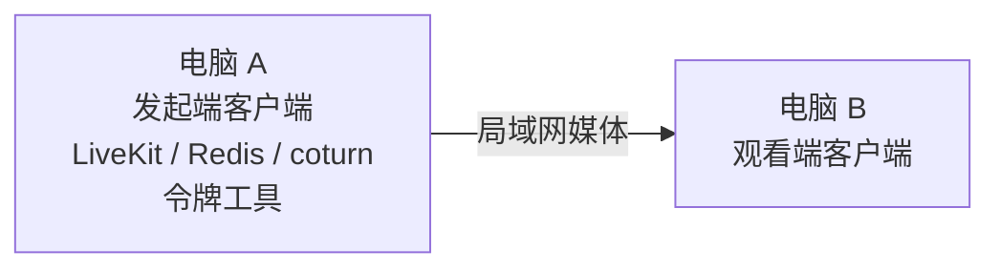
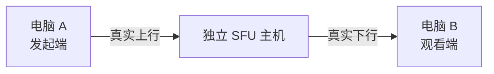

# 双机 1080p60 / 1440p60 实测 SOP

本文档给出一套可重复执行的 Windows 双机实测流程，用于验证 Screen Share 的采集、发布、SFU 转发、订阅、软件内渲染、端到端延迟和 30 分钟稳定性。执行人员应从头到尾记录同一轮次，不得拼接不同提交、不同房间或不同网络条件下的报告。

## 1. 测试结论的适用范围

### 1.1 双机最小拓扑



该拓扑只需要两台 Windows 电脑，适合立即执行工程验证。它能覆盖完整客户端和 SFU 数据路径，但发起端到 SFU 是本机回环链路。因此：

- 可以验证 1080p60/1440p60 实际接收和渲染帧率、可视标记延迟、画面完整性和 30 分钟稳定性；
- 可以验证电脑 A 到电脑 B 的局域网出口/入口能力；
- 不能单独证明独立 SFU 或公网环境中的发起端上行表现；
- 结果应标记为“LAN 双机工程验证”，不能据此宣称产品已完成公网质量验收。

### 1.2 正式 QG-1 拓扑

正式 QG-1 仍使用两台桌面客户端，但 SFU 必须位于独立局域网服务器或受控云服务器：



除 SFU 地址和网络测量目标不同外，后续客户端操作完全相同。若当前只有两台电脑，先执行最小拓扑，待有独立 SFU 后再重跑正式 QG-1。

本 SOP 是单发单收的 M1 测试，不验证 20 名观看者并发；20 人容量属于后续 QG-3。

## 2. 设备分工与最低条件

| 项目 | 电脑 A：发起端 | 电脑 B：观看端 |
| --- | --- | --- |
| 操作系统 | Windows 10 1903+ 或 Windows 11 | Windows 10 1903+ 或 Windows 11 |
| 软件 | ScreenShare、Docker Desktop、Git、Node.js 24、仓库源码 | 同一 ScreenShare 便携包 |
| 显示器 | 1080p 轮次不低于 1920×1080@60Hz；1440p 轮次不低于 2560×1440@60Hz | 1440p 正式轮次建议不低于 2560×1440@60Hz |
| 网络 | 建议千兆有线；关闭 VPN、代理和会抢占带宽的同步任务 | 建议千兆有线；关闭 VPN、代理和会抢占带宽的同步任务 |
| 电源 | 接通电源，关闭自动睡眠、锁屏和节能限帧 | 接通电源，关闭自动睡眠、锁屏和节能限帧 |

基准门槛：

- 1440p60：发起端稳定上行至少 30Mbps，观看端稳定下行至少 25Mbps；
- 1080p60：建议发起端稳定上行至少 15Mbps；
- 两端到 SFU 的 RTT 不高于 80ms，测试前基线丢包不高于 1%；
- 两端系统时钟必须同步；建议时钟偏差不超过 20ms；
- 测试期间不得切换分辨率、刷新率、GPU、网络或电源模式。

## 3. 每轮测试的命名

先为本轮确定唯一编号，后续房间名和结果目录都使用它。例如：

```text
20261118-intel-1440p60-01
```

推荐格式：`日期-发起端GPU-分辨率-序号`。令牌、报告和截图中不要加入人员姓名、设备序列号或其他个人信息。

## 4. 准备同一构建

1. 在 GitHub Actions 中打开目标提交对应的成功 CI。
2. 下载 `screen-share-windows-x64-<40位提交SHA>` artifact。
3. 将同一 ZIP 分别复制到电脑 A、电脑 B，并解压到普通目录。不要直接在 ZIP 内运行。
4. 两端记录 ZIP 的 SHA-256：

```powershell
Get-FileHash .\screen-share-windows-x64-<commit>.zip -Algorithm SHA256
```

5. 确认两端哈希完全相同，并保留 artifact 名称和 CI 运行链接。
6. 不要关闭 Windows 安全防护。便携包当前未签名，只能在专用测试机上运行。

最终端点报告中的 `build_commit`、`app_version` 和 `livekit_sdk_version` 必须完全一致，否则合并器会判定失败。

## 5. 配置双机基础设施

以下命令在电脑 A 的仓库根目录执行。正式 QG-1 使用独立 SFU 时，应在独立基础设施主机执行对应部署，并把下文的 `<SFU_IP>` 替换为该主机地址。

### 5.1 确认局域网地址

在电脑 A 执行：

```powershell
Get-NetIPConfiguration |
  Where-Object { $_.IPv4DefaultGateway -ne $null } |
  Select-Object InterfaceAlias,@{Name='IPv4';Expression={$_.IPv4Address.IPAddress}}
```

记录电脑 A 的 LAN IPv4，例如 `192.168.1.20`，下文记为 `<SFU_IP>`。不要使用 `127.0.0.1`、容器 IP、VPN 地址或临时 IPv6 地址。

确认当前网络属于可信测试局域网，并且 Windows 网络配置文件是 `Private`：

```powershell
Get-NetConnectionProfile
```

不要在酒店、机场或其他不可信网络上开放本测试服务。

### 5.2 准备环境文件

首次运行时：

```powershell
Copy-Item infra/.env.example infra/.env
```

编辑 `infra/.env`，满足以下要求：

```dotenv
LIVEKIT_API_KEY=<仅用于本次开发环境的非空键>
LIVEKIT_API_SECRET=<至少32字符的高熵随机值>
LIVEKIT_NODE_IP=<SFU_IP>
TURN_SHARED_SECRET=<高熵随机值>
```

注意：

- `LIVEKIT_NODE_IP` 必须是电脑 A 的 LAN IPv4，而不是容器 IP；
- `infra/.env` 已被 Git 忽略，禁止提交、截图或发送给无关人员；
- 不要在文档、报告目录或命令历史中写入 API secret；
- 每个测试环境使用独立密钥，完成测试后停止服务并妥善删除临时密钥。

### 5.3 开放仅限 Private 网络的测试端口

在电脑 A 以管理员身份运行 PowerShell：

```powershell
New-NetFirewallRule -DisplayName "ScreenShare Test LiveKit TCP" -Direction Inbound -Action Allow -Profile Private -Protocol TCP -LocalPort 7880,7881
New-NetFirewallRule -DisplayName "ScreenShare Test LiveKit UDP" -Direction Inbound -Action Allow -Profile Private -Protocol UDP -LocalPort 7882
New-NetFirewallRule -DisplayName "ScreenShare Test TURN TCP" -Direction Inbound -Action Allow -Profile Private -Protocol TCP -LocalPort 3478
New-NetFirewallRule -DisplayName "ScreenShare Test TURN UDP" -Direction Inbound -Action Allow -Profile Private -Protocol UDP -LocalPort "3478","49160-49200"
```

如果同名规则已经存在，先用以下只读命令检查，不要重复创建：

```powershell
Get-NetFirewallRule -DisplayName "ScreenShare Test *"
```

### 5.4 启动并检查服务

```powershell
docker compose --env-file infra/.env -f infra/compose.yaml config --quiet
docker compose --env-file infra/.env -f infra/compose.yaml up -d
docker compose --env-file infra/.env -f infra/compose.yaml ps
```

`redis`、`livekit`、`coturn` 应全部处于运行状态，Redis 健康检查应通过。如有异常：

```powershell
docker compose --env-file infra/.env -f infra/compose.yaml logs --tail 100 livekit
docker compose --env-file infra/.env -f infra/compose.yaml logs --tail 100 coturn
```

日志可能含网络元数据；分享前先检查并脱敏。

### 5.5 从观看端验证连通性

在电脑 B 执行：

```powershell
Test-NetConnection <SFU_IP> -Port 7880
Test-NetConnection <SFU_IP> -Port 7881
```

两次结果的 `TcpTestSucceeded` 都应为 `True`。UDP 7882 不能用该命令完整验证，后续成功加入媒体会话才是有效验证。

## 6. 测量网络与时钟基线

### 6.1 同步系统时钟

在两台电脑上以管理员身份执行：

```powershell
w32tm /query /status
w32tm /resync
w32tm /query /status
```

记录时间源、最后成功同步时间和偏差。如果任一设备无法同步，停止测试；否则可视标记延迟会混入时钟误差。

### 6.2 测量 RTT 和基线丢包

最小双机拓扑中，电脑 A、B 相互执行 200 次 ping：

```powershell
ping -n 200 -w 1000 <对端LAN_IP>
```

正式 QG-1 拓扑中，两端都对 `<SFU_IP>` 执行该命令。记录汇总中的平均 RTT 和丢包百分比。任一方向丢包超过 1% 或 RTT 超过 80ms 时，本轮不进入正式记录。

### 6.3 测量双机带宽

使用受信来源的 `iperf3`，并在测试记录中写明版本。先在电脑 B 启动服务：

```powershell
iperf3.exe -s
```

在电脑 A 测量 A→B：

```powershell
iperf3.exe -c <B_IP> -t 30 -P 4
```

再测量 B→A：

```powershell
iperf3.exe -c <B_IP> -R -t 30 -P 4
```

使用接收端汇总值填写客户端：

| 客户端字段 | 使用的结果 |
| --- | --- |
| 电脑 A 上行 | A→B 接收端汇总 Mbps |
| 电脑 A 下行 | B→A 接收端汇总 Mbps |
| 电脑 B 上行 | B→A 发送方向的有效 Mbps |
| 电脑 B 下行 | A→B 接收端汇总 Mbps |

正式 QG-1 拓扑应分别测量电脑 A→SFU 的上行和 SFU→电脑 B 的下行，不要用互联网测速站结果替代实际 SFU 路径。

带宽测试结束后停止 `iperf3`，避免它与媒体测试竞争带宽。

## 7. 生成本轮短时令牌

在电脑 A 的仓库根目录先安装锁定依赖：

```powershell
npm ci
```

使用本轮编号生成 90 分钟令牌：

```powershell
npm run validation:tokens -- --env-file infra/.env --server-url ws://<SFU_IP>:7880 --room <本轮编号> --host-identity validation-host --viewer-identity validation-viewer --ttl-minutes 90
```

只在两台测试机之间临时传递以下字段：

| 角色 | 服务器 URL | 访问令牌 | 发起者身份 |
| --- | --- | --- | --- |
| 电脑 A | `serverUrl` | `host.token` | 留空 |
| 电脑 B | `serverUrl` | `viewer.token` | `viewer.publisherIdentity` |

禁止把命令输出重定向到文件、提交到 Git、粘贴到 Issue 或放入验收报告。若连接前已过去较长时间，重新生成一组令牌。

## 8. 配置测试画面

每个分辨率必须单独执行完整 30 分钟轮次：

| 轮次 | 电脑 A 显示设置 | 预期捕获尺寸 | 用途 |
| --- | --- | --- | --- |
| 1080p60 | 1920×1080，60Hz | 1920×1080 | 性能基线；当前 QG-1 合并器会因不足 1440p 而判定失败 |
| 1440p60 | 2560×1440，60Hz | 2560×1440 | 正式 QG-1 候选轮次 |

在电脑 A 的共享显示器上准备持续动态内容，例如本地 60fps 视频、滚动文本、窗口拖动和动画图表的组合。避免使用受 DRM 保护的视频、个人资料、密码管理器、聊天窗口或其他敏感画面。

分辨率或刷新率改变后重新启动 ScreenShare，并点击“刷新列表”。验收必须选择整块“屏幕”，不能选择单个窗口，因为可视延迟标记只支持整屏验收。

## 9. 建立单发单收会话

### 9.1 电脑 A：发起端

1. 启动 `ScreenShare.exe`。
2. 点击“刷新列表”，选择目标整块屏幕。
3. 在“LiveKit 房间”填写 `serverUrl` 和 `host.token`，“发起者身份”留空。
4. 在“实机验收环境”填写电脑 A 的上行、下行、RTT、基线丢包和 `1.13.11` SFU 版本。
5. 基线丢包字段填写百分数：无丢包填 `0`，0.2% 填 `0.2`，不要填比例 `0.002`。
6. 勾选“以上网络数据已在本次运行前实测”。
7. 点击“开始捕获”，确认本地 GPU 预览正常，状态尺寸与本轮目标一致。
8. 点击“开始发布”，等待状态进入发布中。

### 9.2 电脑 B：观看端

1. 启动同一构建的 `ScreenShare.exe`。
2. 在“LiveKit 房间”填写 `serverUrl`、`viewer.token` 和 `viewer.publisherIdentity`。
3. 填写电脑 B 实测的上行、下行、RTT、基线丢包和相同 SFU 版本。
4. 勾选“以上网络数据已在本次运行前实测”。
5. 点击“加入观看”，等待软件内画面出现。

### 9.3 记录前预热两分钟

至少观察两分钟：

- 电脑 A 状态中的 `C/E/S` 有持续数据；
- 电脑 B 状态中的 `Rx/D/R` 有持续数据；
- 观看端显示尺寸等于本轮目标；
- 六段实际帧率稳定，60fps 目标下主要阶段应接近 55–60fps；
- 没有持续黑屏、花屏、画面冻结或队列丢弃连续增长；
- 丢包不持续超过 1%。

同时打开 Windows 任务管理器的 GPU 性能页，观察电脑 A 的 `Video Encode` 和电脑 B 的 `Video Decode` 引擎。记录使用的 GPU 和引擎活动；如果无法确认 H.264 硬件编解码，本轮只能标记为软件或未确认路径，不能代替正式硬件基准。

预热不满足时不要开始 30 分钟记录。先排除网络、显示器分辨率、驱动或媒体连接问题。

## 10. 执行 30 分钟记录

严格按以下顺序操作：

1. 在电脑 A 点击“开始 30 分钟验收记录（显示延迟标记）”。
2. 确认共享屏幕左上角出现黑白时间码标记。
3. 在电脑 B 确认画面仍正常后，点击同名验收按钮。
4. 记录两端开始时间；两端启动间隔应尽量控制在 30 秒以内。
5. 让动态内容持续运行 30 分钟。不要最小化观看端、锁屏、切换网络、改变分辨率或停止发布。
6. 每 5 分钟人工记录一次状态：实际尺寸、六段 fps、码率、丢包、队列丢弃、画面异常和进程是否存活。
7. 等待两端各自达到 `30:00` 并自动保存。提前点击“停止并保存”生成的报告只能用于失败分析，不能通过 `duration_30_minutes`。

建议使用以下人工检查表：

| 时刻 | Host C/E/S | Viewer Rx/D/R | Viewer 尺寸 | 码率 | 丢包 | 黑屏/花屏/冻结 | 备注 |
| --- | --- | --- | --- | --- | --- | --- | --- |
| 00:00 |  |  |  |  |  |  |  |
| 05:00 |  |  |  |  |  |  |  |
| 10:00 |  |  |  |  |  |  |  |
| 15:00 |  |  |  |  |  |  |  |
| 20:00 |  |  |  |  |  |  |  |
| 25:00 |  |  |  |  |  |  |  |
| 30:00 |  |  |  |  |  |  |  |

## 11. 独立复核端到端延迟

客户端会自动从实际解码帧生成可视标记 P50/P95/最大值，但正式 QG-1 还需要独立方法复核，不能用 RTT 代替。

推荐使用 120fps 或 240fps 摄像机，让电脑 A 和电脑 B 的显示器同时进入画面：

1. 在共享屏幕显示一个无敏感内容的高对比度闪烁图案或大号毫秒计时器。
2. 在 30 分钟内均匀采集至少 60 次明显画面变化。
3. 对每次变化分别记录它首次出现在电脑 A 和电脑 B 的摄像帧编号。
4. 使用公式计算：`延迟毫秒 = 帧号差 ÷ 摄像帧率 × 1000`。
5. 将 60 个延迟从小到大排序，P95 取第 `ceil(0.95 × 样本数)` 个值。

例如 240fps 视频中相差 72 帧，延迟为 `72 ÷ 240 × 1000 = 300ms`。

摄像视频可能包含屏幕内容，不得上传到公共仓库或公开 Issue。没有独立延迟样本时，本轮只能作为工程数据，不能为合并器编造 `--latency-p95-ms`。

## 12. 收集端点报告

报告默认位于两台电脑各自的：

```text
%USERPROFILE%\Documents\ScreenShare\validation
```

文件名：

```text
qg1-host-yyyyMMdd-HHmmss.json
qg1-viewer-yyyyMMdd-HHmmss.json
```

将本轮两个 JSON 复制到电脑 A 的独立结果目录，例如：

```text
validation-results\<本轮编号>\endpoint-host.json
validation-results\<本轮编号>\endpoint-viewer.json
```

复制前打开 JSON 顶部核对：

- host 的 `endpoint_role` 是 `host`，viewer 是 `viewer`；
- 两端 `build_commit`、`app_version`、`livekit_sdk_version`、`environment.sfu_version` 相同；
- `contains_screen_content` 和 `contains_credentials` 都是 `false`；
- 1440p 轮次活动样本的 `width`/`height` 是 2560/1440；
- viewer 的 `visual_latency_sample_count` 至少 90,000；
- 报告不含令牌、服务器 URL、身份或屏幕内容。

## 13. 合并并判定 1440p60 结果

在电脑 A 的仓库根目录执行。只有实际复查确认没有相应问题时，才能加入三个 `--no-*` 参数：

```powershell
node tools/qg1-evaluate.mjs `
  --host .\validation-results\<本轮编号>\endpoint-host.json `
  --viewer .\validation-results\<本轮编号>\endpoint-viewer.json `
  --latency-p95-ms <独立测量的P95毫秒> `
  --no-visual-corruption `
  --no-crash `
  --no-device-loss `
  --output .\validation-results\<本轮编号>\qg1-combined.json
```

若出现过黑屏/花屏、崩溃或未恢复的 GPU 设备丢失，必须省略对应参数；合并结果应为失败。工具返回退出码 `1` 表示门槛失败，但仍会写出合并报告用于分析。

查看结果：

```powershell
$result = Get-Content .\validation-results\<本轮编号>\qg1-combined.json -Raw | ConvertFrom-Json
$result.qg1_status
$result.checks.PSObject.Properties | Select-Object Name,Value | Format-Table -AutoSize
```

通过要求包括：

- `qg1_status` 为 `pass`，所有 `checks` 都为 `true`；
- 两端连续记录至少 30 分钟，所有采样点媒体保持活动；
- viewer 平均 render 不低于 55fps，且没有超过 500ms 的 render 空档；
- viewer 有至少 90,000 个有效可视标记样本，可视标记 P95 不高于 500ms；
- 独立实测 P95 不高于 500ms；
- 两端活动样本均为至少 2560×1440；
- 两端平均丢包不高于 1%，进程工作集增长不高于 10%；
- 无永久黑屏/花屏、无崩溃、无未恢复设备丢失。

1080p60 轮次是性能基线。可以运行同一合并工具观察其他检查项，但 `host_1440p_media` 和 `viewer_1440p_media` 会按设计返回 `false`，因此不能期望 1080p60 报告通过 QG-1。

## 14. 失败时如何处理

出现以下任一情况，本轮标记为失败并保留现场，不要通过重启后继续累计时间：

- 任一客户端崩溃、无响应或媒体连接永久断开；
- 观看端永久黑屏、持续花屏或超过 500ms 的明显冻结；
- 分辨率不是本轮目标，或者 viewer 平均 render 低于 55fps；
- 时间码在 host 不可见，或 viewer 有效样本不足 90,000；
- 系统时钟失步、网络条件改变、设备睡眠或测试人员误停止发布；
- 报告提交 SHA、SDK 或 SFU 版本不一致。

失败材料至少包含：

- 本轮编号、开始/结束时间、设备 GPU/驱动/Windows 版本；
- 两端脱敏端点 JSON 和合并报告；
- 人工检查表、独立延迟样本及计算过程；
- 故障发生时刻和可复现步骤；
- 已去除令牌、API secret、个人屏幕内容和身份信息的必要日志。

不要把访问令牌、`infra/.env`、摄像原片或含个人内容的截图上传到公开 Issue。

## 15. 测试结束与清理

在电脑 A 停止基础设施：

```powershell
docker compose --env-file infra/.env -f infra/compose.yaml down
```

确认不再需要本轮端口后，以管理员身份删除本 SOP 创建的特定防火墙规则：

```powershell
Get-NetFirewallRule -DisplayName "ScreenShare Test *" | Remove-NetFirewallRule
```

关闭客户端，撤销临时共享，安全保存脱敏报告。短时媒体令牌到期后失效，但仍不应存档或传播。

## 16. 完整矩阵记录模板

| 字段 | 记录值 |
| --- | --- |
| 本轮编号 |  |
| 测试拓扑 | 双机最小 / 独立 SFU |
| CI 运行链接 |  |
| artifact 名称与 ZIP SHA-256 |  |
| 客户端提交 |  |
| 电脑 A GPU / 驱动 / Windows |  |
| 电脑 B GPU / 驱动 / Windows |  |
| A Video Encode / B Video Decode 证据 |  |
| SFU 版本与部署位置 |  |
| A/B 显示分辨率与刷新率 |  |
| A 上行 / 下行 Mbps |  |
| B 上行 / 下行 Mbps |  |
| A/B 到 SFU RTT |  |
| A/B 基线丢包 |  |
| 时钟同步状态与估计偏差 |  |
| 测试分辨率 | 1080p60 / 1440p60 |
| host 报告文件 |  |
| viewer 报告文件 |  |
| 可视标记 P50 / P95 / max |  |
| 独立延迟样本数 / P95 |  |
| 黑屏、花屏、崩溃、设备丢失 |  |
| 合并报告文件 |  |
| 最终结果 | 工程通过 / QG-1 通过 / 失败 |
| 备注与缺陷链接 |  |

Intel、NVIDIA、AMD 三类发起端 GPU 都至少需要一轮 1080p60 和一轮 1440p60。只有三类硬件的正式 1440p60 轮次均取得可复核证据后，M1 才能退出。
